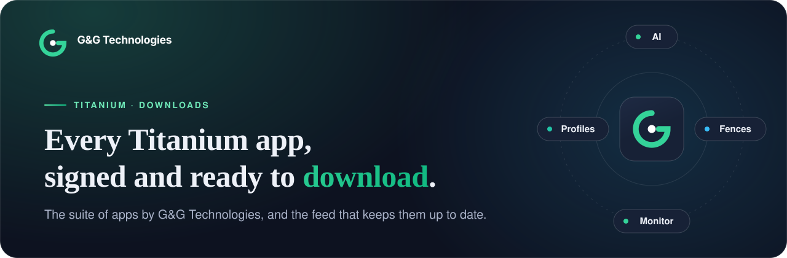

<a href="https://ggtechnologies.sm/gg-releases/">
  
</a>

<p align="center">
  <b><a href="https://ggtechnologies.sm/gg-releases/">Browse the downloads</a></b>
  &nbsp;&nbsp;·&nbsp;&nbsp;
  <a href="../../releases">All releases</a>
  &nbsp;&nbsp;·&nbsp;&nbsp;
  <a href="https://ggtechnologies.sm/">ggtechnologies.sm</a>
</p>

<p align="center">
  The official home of <b>Titanium</b>, the suite of apps by <b>G&amp;G Technologies</b>:<br>
  every release, ready to download, and the update feed the apps use to keep themselves current.
</p>

<p align="center"><sub>Il sito dei download è disponibile anche in italiano.</sub></p>

<br>

## The Titanium suite

<table>
  <tr>
    <td width="50%" valign="top">
      <h3>Titanium AI</h3>
      <p>Local AI on Apple silicon. An inference runtime built around unified memory, with an OpenAI-compatible API, to run language models on your own Mac.</p>
      <sub><b>macOS</b> · Apple silicon</sub>
    </td>
    <td width="50%" valign="top">
      <h3>Titanium Fences</h3>
      <p>Control over what your AI applications connect to. It allows only the destinations you have authorized, blocks the others and records every decision: metadata only, never the content.</p>
      <sub><b>macOS</b></sub>
    </td>
  </tr>
  <tr>
    <td width="50%" valign="top">
      <h3>Titanium Monitor</h3>
      <p>A menu bar utility that shows how CPU, GPU, memory, network and disk are being used, tells you in plain words what is weighing the system down, and frees the space taken by caches and leftovers, always through the Trash.</p>
      <sub><b>macOS</b></sub>
    </td>
    <td width="50%" valign="top">
      <h3>Titanium Profiles</h3>
      <p>Several Claude Desktop accounts side by side on the same computer, for example a company account and a personal one.</p>
      <p><sub>An unofficial tool, not affiliated with Anthropic. It never modifies Claude Desktop and never reads credentials.</sub></p>
      <sub><b>macOS</b> · <b>Windows</b></sub>
    </td>
  </tr>
</table>

## Built to be trusted

<table>
  <tr>
    <td width="33%" valign="top">
      <h4>Signed and notarized</h4>
      macOS downloads are signed with our Apple Developer ID and notarized by Apple.
    </td>
    <td width="33%" valign="top">
      <h4>A checksum for every file</h4>
      Every file is published with its SHA-256 checksum, next to the file in its release.
    </td>
    <td width="33%" valign="top">
      <h4>A release never changes</h4>
      A published file is never replaced. A fix is always a new version.
    </td>
  </tr>
</table>

## Downloading

The [downloads page](https://ggtechnologies.sm/gg-releases/) lists the latest version of each
app. Every release is also under [Releases](../../releases), tagged `<app>-v<version>`.

Pick the file for your system. Next to every file is its `.sha256`, to check the download:

```bash
shasum -a 256 -c <file>.sha256
```

## Automatic updates

The Titanium apps find their updates here, and verify every download before using it.
Nothing about you or your computer is sent when they check.

<br>

---

<p align="center">
  <a href="https://ggtechnologies.sm/"></a>
</p>

<p align="center">
  <b>G&amp;G Technologies</b><br>
  <sub>POWERING THE FUTURE</sub>
</p>

<p align="center">
  <sub>
    © G&amp;G Technologies Srl · Via Marino Moretti 23, 47899 Serravalle, Republic of San Marino<br>
    <a href="https://ggtechnologies.sm/">ggtechnologies.sm</a> · <a href="mailto:info@ggtechnologies.sm">info@ggtechnologies.sm</a>
  </sub>
</p>
